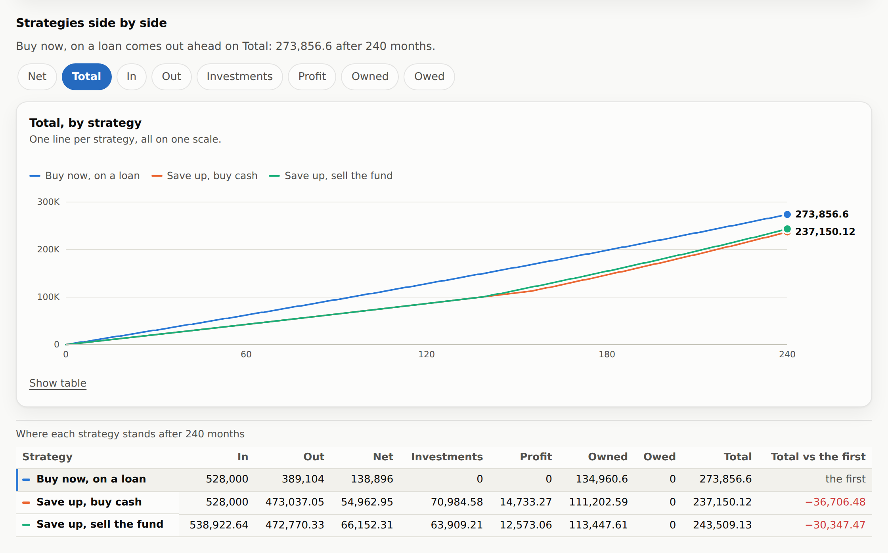

# Finapp

Project income, expenses, cash and total worth over the next 1–600 months.
Compare up to four scenarios for each of six projects. Everything is calculated
in the browser. Connecting a Google account for optional Drive backups is a
separate choice; a session service holds only authentication credentials.

[](https://github.com/sinikebe/finapp/actions/workflows/ci.yml)
[](https://finapp.siniverse.cc/)

**[Open Finapp](https://finapp.siniverse.cc/)** · [Legacy development address](https://sinikebe.github.io/finapp/dev/) · English and French ·
light and dark themes · installable PWA

The logo opens the finapps application menu, with links to Finapp and Garapp.
Development versions link to each other; main versions link to main versions.
Switching applications does not transfer project data.



## Simple or Advanced

The **Presentation** dropdown offers three arrangements of the same data:
**Horizon** puts results first with editing on demand, **Atelier** lets you edit
real scenario amounts side by side, and **Parcours** provides three steps with
a live recap. The choice is remembered separately from Simple/Advanced and
light/dark appearance. The open project's last section and guided step are
remembered locally. **Appearance** is available in the header; **Tools** groups
Simple/Advanced, language, currency, backups and exports.
Information buttons beside headings and settings open supporting explanations.
They work by click, touch and keyboard, and close with Escape or the Close button.
Navigation, accessible controls and all financial rules
are shared. In the Peugeot example, annual mileage recalculates the energy
provisions from the documented catalogue assumptions; manually edited energy
budgets are labelled as custom usage.

**Ctrl/⌘K** opens searchable actions. Tools can export a CSV comparison, print
results to PDF, save complete backups and restore a dropped JSON file after a
preview. Native file saving and sharing are used when available, with ordinary
download and copy-link fallbacks. Cancelling a file picker does not download a
second copy. **Ctrl/⌘Z** triggers the visible Undo outside editable controls.

Simple starts with a guided choice: a budget, two scenarios to compare, a cash
savings goal, or clearly marked examples. Personal projects start with blank
figures. Simple keeps loan essentials, a cash/worth chart, scenario comparison
and all cash warnings. The summary and comparison appear before the long form
on phones.

Advanced opens the generic editor, conditional dates, multiple target metrics,
the solver, manual linking, full charts, flows and sensitivity analysis. Both
views use exactly the same financial data and results. Switching modes is a
local presentation preference and preserves all advanced rules.

## Build a plan

A project is one question, such as buying a home or paying for a car. Each
strategy is an alternative answer with its own editable fields. Strategies in a
project share a horizon and targets. Inflation, the return range and tax
assumptions apply to all projects.

Every financial input is a field:

| Kind | Meaning |
| --- | --- |
| Amount | Recurring income or spending, monthly, quarterly, half-yearly or yearly; optional annual change. |
| One-off | A receipt or payment in one month. |
| Loan | Amount required, financed fees, annual interest and a monthly repayment term. Incoming loans represent money owed to you. |
| Investment | Contributions leave cash and build a balance with monthly growth. An optional sale converts the holding to cash. |
| Something you own | An asset with a present value, acquisition month and appreciation or depreciation. It does not itself move cash. |

Fields can have start/end dates and can be synchronized across strategies.
Synchronized fields share one identity: editing or deleting one affects its
counterparts, while duplication creates an independent field.

Amounts accept decimal points, French decimal commas and grouping spaces.
English comma grouping such as `1,234.56` is also accepted. **Rates never use
comma grouping:** `3,125` and `3.125` both mean a rate of 3.125%. Currency affixes such as `2 200 €` are accepted. Invalid entries stay visible
with an inline error; results continue to use the last valid value.

The example collection contains a worked home-buying comparison and housing/car templates.
Template figures are examples to replace, not offers or tax advice. Their
shared rows stay synchronized. A 48-month lease has one initial rent and 47
ordinary rents.

**Peugeot 308 · four powertrains** compares new Allure hatchbacks in petrol,
diesel, electric and non-plug-in 48 V hybrid form. Open **Projects → Start from
a template** to add it to an existing workspace. It uses a dated French May
2024 catalogue, 2024 energy prices, a five-year cash purchase and 15,000 km/year.
The results disclose sources and distinguish WLTP/list-price facts from
estimated maintenance, insurance, charger and depreciation budgets.
[Assumptions, source tables and exclusions](docs/car-energy-example.md).

## Read the results

The summary reports cumulative inflows, outflows and cash kept. A balance sheet
adds investments and assets and deducts debt. A cash shortfall is reported even
when the final or average balance is positive.

- Charts can show running totals or changes during each month.
- Each chart has an exact-value table and supports keyboard readings.
- The comparison uses the same horizon and a common scale for its strategies.
- A flow diagram shows income, pooled cash, spending and what remains.
- A sensitivity ranking varies one amount at a time, holding the already
  resolved dates fixed. It measures the entered figures, not the causal link
  between a mortgage and the home it bought.

The worked example illustrates why the horizon matters: borrowing wins over
20 years; both renting strategies finish ahead over 40 years under the example's
assumptions. Changing those assumptions can change the answer.

## Targets and conditional dates

A target asks when a quantity reaches a figure. Name it to let fields start,
end or sell when it is reached. Dates resolve against the trajectory without
that target's own consequences; cycles are reported instead of guessed.

Renaming a target preserves its amount and identity. A target in use cannot be
removed until its fields have been given a month or another target. An unnamed
but still referenced target remains selectable. An older or damaged store with
a missing reference shows the broken link explicitly, so it can be repaired.

**What would it take?** searches an amount or rate and checks the answer on the
complete original plan. With fixed dates it can give a lower/upper bound.
With conditional dates it offers a checked example, since another figure can
move an event and change the relationship. Suggestions are never applied
without editing the figure yourself.

Return-range scenarios also start from the original fields: an optimistic
scenario can trigger a purchase that the central scenario never reaches.

## Financial conventions

- Amounts are in your own currency; no conversion is performed.
- The timeline starts at month 0. Cash flows start at zero; existing assets and
  debts are carried at their opening values. There is no separate opening cash
  balance field. Adding money as a one-off income also increases reported income.
- Rates on balances are **nominal annual percentages divided by twelve**.
  An amount's annual change happens on its anniversary instead.
- A contribution is made after that month's investment growth. Money and
  repayments are rounded to cents at each step.
- **Cash and total worth are before investment tax, even after a sale.** Only
  the net-profit figure applies the entered tax rate to aggregate gains. Losses
  do not create a tax credit. This is a gross balance-sheet model, not a complete
  after-tax cash-flow simulation.
- Housing-template taxes are fixed example fields. They do not automatically
  recalculate from a household's real tax position.
- Today's-money values divide each month's balance by the same inflation
  deflator. The model is a deterministic scenario, not a probability forecast.

## Saving, recovery and sharing

The complete workspace is saved in one atomic `localStorage` record. Writes are
serialized between tabs, and an outdated tab cannot silently replace a newer
revision. Background changes are deferred while a control is being edited and
reconciled afterward. Conflicts are shown with actions to load the saved version
or download the open work as a backup.

A per-tab recovery draft is staged before the delayed save, so closing a tab
before its save completes does not discard the last edit. A later opening offers
the latest unsaved draft. **Download a backup** in Tools or About exports every project
and any recovery drafts as JSON. **Restore a backup** in Tools validates the
file, previews its projects and drafts, and explicitly replaces the workspace
after saving a recovery copy of the current projects. Keep a separate copy if the data matters:
clearing browser storage removes the workspace and its drafts.

The old `sinikebe.github.io` entry points redirect to Finapp's new address.
Browser storage stays on its original origin. To recover projects on each
device, open the [old production recovery page](https://sinikebe.github.io/finapp/recovery.html)
or [old development recovery page](https://sinikebe.github.io/finapp/dev/recovery.html),
use **Download a backup** in Tools, then **Restore a backup** on the new site.
The recovery app uses the existing local workspace and export controls; no
project data is transferred automatically. Keep the downloaded JSON and the old
browser data until the projects have been checked.

Previously downloaded **raw rescue** JSON files remain readable by the same
**Restore a backup** action. It lists the original environment and offers
reconciled projects, older snapshots, historical v2/v1 inputs and unsaved drafts
for preview before replacement. Regular backups are limited to 20 MiB; legacy
rescue files are limited to 64 MiB and never write old storage keys into the new app.

The profile icon at the top right opens **Google Drive** without looking through
settings. It is red when disconnected and shows the current Google account while
connected. Production can restore an active session when the app reopens.
Finapp keeps no Google access token or account identity in browser storage.
Google Drive lets you keep
versioned copies of the complete workspace. Choose or create a Finapp backup,
then synchronize manually or enable automatic synchronization while the app is
open and connected. When another device has different changes, compare only
the differences before choosing the local copy, the Drive copy or a merge.
Previous Drive versions remain available; JSON downloads and restoration still
work independently. A local recovery copy is kept before replacing the open
workspace. [How Drive backup and recovery work](docs/google-drive.md).

If saving fails, a visible message says so. Without safe storage/coordination,
the app remains editable and exportable but does not claim changes were saved.
Older stores are migrated without deleting their only copy first. Compatibility
mirrors let older builds read the active project; those mirrors are no longer
the authoritative save.

**Share sends one project, not the shelf.** A URL fragment carries its fields,
strategies, targets and assumptions. Target names and references survive the
transfer. Opening it offers a separate project or addition to the current
comparison; additions preserve existing targets and explain if there is no room.
The link is removed from the address after the choice.

Version 1 links without conditional references remain readable. Old conditional
links omitted target identities, so they cannot be reconstructed reliably and
are refused rather than silently altered. Current links use version 2.

A link is encoded, **not encrypted**: anyone with it can read the plan. The
fragment is not sent in the document's HTTP request. Plans remain accessible to
other scripts with the same origin and to browser extensions with sufficient
permissions; browser storage is not an encrypted vault.

Finapp sends a backup to Google Drive only after you connect and choose a
backup there. The temporary access token stays in memory; production restores
an active session through a separate credential service after the tab closes.
The service never receives backup contents. Drive copies stay in the connected Google account,
not encrypted by Finapp; protect access to that account as you would any
financial records. The production and development apps use separate backup
spaces, and Finapp does not show Garapp backups.

## Offline support and browser support

A service worker precaches the page, styles, scripts and icons as one versioned
generation. New builds offer a reload. The app also checks for updates when
opened and provides a manual check in About.

The supported baseline is Chrome/Edge 89+, Firefox 98+ and Safari 15.4+ for
ES modules, native dialogs and the browser APIs used here. Safe coordinated
saving uses Web Locks in a secure context (HTTPS or localhost). When that is
unavailable the app shows its saving limitation. Installability depends on the
browser; Safari uses Add to Home Screen.

The development preview installs as **Finapp dev**; the main application keeps
the name **Finapp**. Both language variants use the corresponding name.

## Development

Use Node 22.12 or later for pinned deployment tooling:

```sh
npm ci
npm start
npm test
```

The application has no runtime dependencies. The development dependency is a pinned
Wrangler for production and [Worker Previews](docs/cloudflare-previews.md). See [CONTRIBUTING.md](CONTRIBUTING.md)
for the module map, release steps, storage contract and validation workflow.
GitHub-hosted Actions publishes production on a push to `main` and the stable
`dev` Preview on a push to `dev`, after validation. PRs and default manual runs
validate without Cloudflare credentials or publication; the manual `deploy`
checkbox can publish the current `main` or `dev`. The deployment guide
lists the two repository secret names and the remaining setup steps; old
Cloudflare Workers Builds triggers stay disabled.
The design system is documented in [docs/design-system.md](docs/design-system.md).
The [review correction log](docs/review-fixes.md) maps the reviewed defects to
their fixes, checks and migration limits.

## License

[MIT](LICENSE).
